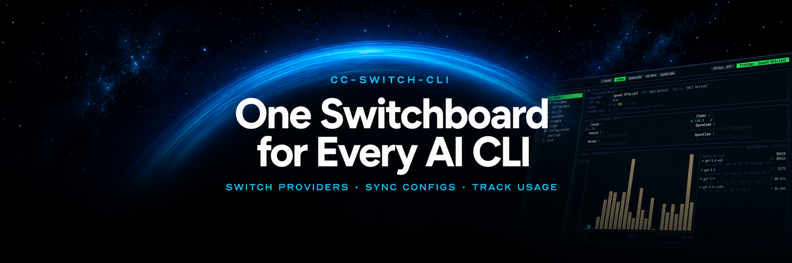
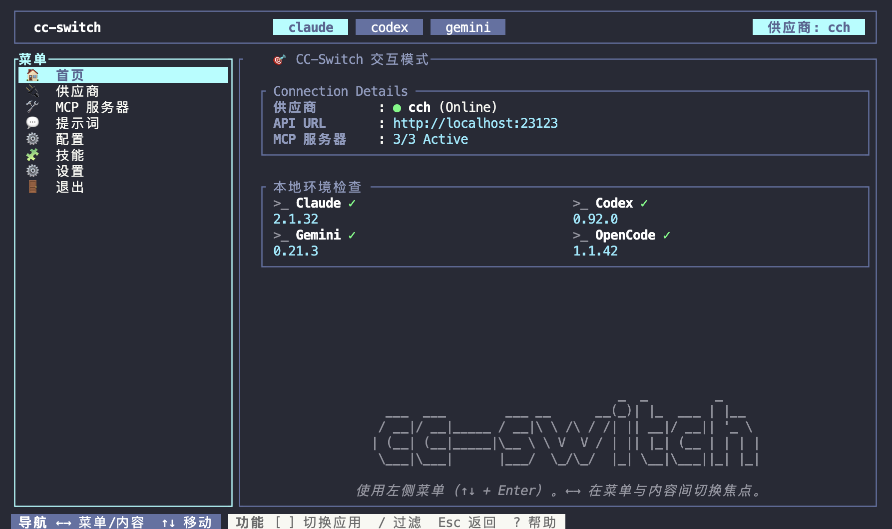

<div align="center">

## CC-Switch CLI

**通过交互式 TUI 或脚本化 CLI，统一管理 Claude Code、Codex、Gemini、Grok Build、OpenCode、Hermes、OpenClaw 和 Pi。**

[](https://github.com/saladday/cc-switch-cli/releases)
[](https://github.com/saladday/cc-switch-cli/releases)
[](https://www.rust-lang.org/)
[](LICENSE)

[English](README.md) | 中文 | [日本語](README_JA.md)

</div>

---

## 📖 关于本项目

本项目是原版 [CC-Switch](https://github.com/farion1231/cc-switch) 的 **CLI 分支**。🔄 WebDAV 同步功能与上游项目完全兼容。


**更新日志：** [CHANGELOG.md](CHANGELOG.md)

---

## ❤️赞助商

<table>
  <tr>
<td width="180"><a href="https://88api.ai/sign-up?aff=TeNl"></a></td>
<td>感谢 88API Token聚合平台赞助了本项目！88API 是一家由香港企业运营并且主要面向开发者、创作者与 AI 应用用户的一站式多模型 API 平台，通过统一接口接入文本、图片、语音和视频模型，覆盖 AI 编程、智能翻译、内容创作、配音、图像生成、视频生成等常见工作流。可以直接在 CC-Switch CLI 中完成 Provider 添加并切换，支持国际主流付款方式，可提供发票，提供企业级稳定服务。通过<a href="https://88api.ai/sign-up?aff=TeNl">此链接</a>注册可以获取专属赠送额度！</td>
</tr>
  <tr>
<td width="180"><a href="https://go.apimart.ai/gh-cc-switch-cli"></a></td>
<td>感谢 APIMart 赞助了本项目！APIMart 是专注 AI 图片/视频生成的低价 API 平台，GPT-Image-2 低至 $0.006/张，1 美元可出图 160+ 张。图片、视频一套异步 API 通吃，提交任务拿 ID、回调取结果，跑批万张不超时、换模型不改代码。按量付费、无月费，通过<a href="https://go.apimart.ai/gh-cc-switch-cli">此注册链接</a>注册即可开用。</td>
</tr>
  <tr>
    <td width="180">
      <a href="https://cubence.com/signup?code=SC3M1CAH&source=ccscli">
        
      </a>
    </td>
    <td>
      感谢 <b>Cubence</b> 赞助本项目！Cubence 是一家致力为客户提供稳定、高效的API中转服务商。从25年9月运营至今，提供了Claude code、Codex、Gemini等多种模型支持。通过<a href="https://cubence.com/signup?code=SC3M1CAH&source=ccscli">此链接</a>注册，并在充值时使用 <code>CCSCLI</code> 优惠码享受9折优惠。
    </td>
  </tr>
  <tr>
    <td width="180">
      <a href="https://www.openmodel.ai/?ref=JGDNqZl8">
        
      </a>
    </td>
    <td>
      一个API，顶级模型随便用！<a href="https://www.openmodel.ai/?ref=JGDNqZl8"><b>OpenModel</b></a> 专注于生产级、高可用的 AI API 网关，让你的应用真正做到高速稳定：自动故障转移、智能选最优渠道、生产级 SLA 保障。远超单一供应商的 SLA，让稳定性成为您的核心竞争力。
    </td>
  </tr>

  <tr>
    <td width="180">
      <a href="https://www.packyapi.com/register?aff=cc-switch-cli">
        
      </a>
    </td>
    <td>
      感谢 <b>PackyCode</b> 赞助本项目！<br/>
      官网：<a href="https://www.packyapi.com">https://www.packyapi.com</a><br/>
      CC-Switch CLI 专属优惠：通过
      <a href="https://www.packyapi.com/register?aff=cc-switch-cli">此链接</a>
      注册，并在充值时填写优惠码 <code>cc-switch-cli</code>，即可享受 <b>9 折优惠</b>。
    </td>
  </tr>
  <tr>
    <td width="180">
      <a href="https://ddshub.short.gy/ccscli">
        
      </a>
    </td>
    <td>
      感谢 <b>DDS</b> 赞助本项目！呆呆兽是一家专注 Claude 的可靠高效 API 中转站，为个人和企业用户提供极具性价比的国内 Claude 直连加速服务。支持 <b>Claude Haiku / Opus / Sonnet 等满血模型</b>。充值满 1000 元即可开具发票，企业客户更可享受定制化分组和技术支持服务。<br/>
      CC-Switch CLI 用户专属福利：通过<a href="https://ddshub.short.gy/ccscli">此链接</a>注册后，首单充值可<b>额外赠送 10% 额度</b>（充值后请联系群主领取）！
    </td>
  </tr>
</table>

---

## 📸 截图预览

<div align="center">
  <h3>首页</h3>
  
</div>

<br/>

<table>
  <tr>
    <th>切换</th>
    <th>设置</th>
  </tr>
  <tr>
    <td></td>
    <td></td>
  </tr>
</table>

## 🚀 快速开始

**TUI 模式（推荐）**
```bash
cc-switch
```
使用全屏界面切换供应商、管理账号、查看会话并检查代理状态。

**命令行模式**
```bash
cc-switch provider list              # 列出供应商
cc-switch provider switch <id>       # 切换供应商
cc-switch use <id>                   # 切换供应商（快捷命令）
cc-switch provider export <id>       # 导出 Claude 供应商为独立 settings 文件
cc-switch provider stream-check <id> # 检查供应商流式健康
cc-switch start claude <id>          # 用指定供应商启动 Claude，不切换全局供应商
cc-switch start codex <id>           # 用指定供应商启动 Codex，不切换全局供应商
cc-switch start codex <id> --shared-sessions # 不同供应商共享持久化 Codex 历史
cc-switch start claude <id> --dry-run # 仅预览启动配置
cc-switch auth list                  # 查看托管的 ChatGPT/Codex OAuth 账号
cc-switch sessions list --all        # 查看历史会话
cc-switch sessions sync-usage --all  # 导入本地会话 token / cost 用量
cc-switch config webdav show         # 查看 WebDAV 同步设置
cc-switch env tools                  # 检查本地 CLI 工具
cc-switch mcp sync                   # 同步 MCP 服务器
cc-switch proxy show                 # 查看代理路由和状态

# 使用全局 `--app` 参数来指定目标应用：
cc-switch --app claude provider list    # 管理 Claude 供应商
cc-switch --app codex mcp sync          # 同步 Codex MCP 服务器
cc-switch --app gemini prompts list     # 列出 Gemini 提示词
cc-switch --app hermes provider list    # 管理 Hermes 供应商
cc-switch --app openclaw provider list  # 管理 OpenClaw 供应商
cc-switch --app grokbuild provider list # 管理 Grok Build 供应商
cc-switch --app pi provider list        # 管理 Pi 供应商

# 支持的应用：`claude`（默认）、`codex`、`gemini`、`opencode`、`hermes`、`openclaw`、`pi`
```

需要在多个终端同时使用不同供应商时，请使用 `cc-switch start`。它只影响由该命令启动的 Claude 或 Codex 会话；`provider switch` 和 `use` 仍会切换全局供应商。在 TUI 的供应商页选中供应商后按 `o`，效果相同。

在 macOS/Linux 上，为 `start codex` 添加 `--shared-sessions`，即可共享当前配置的 Codex 目录中的会话、归档会话和 SQLite 历史索引。各供应商使用该目录下 `.cc-switch-launches/` 中独立、持久化的私有目录；Codex 会通过这些目录记录会话路径，因此请保留它们。不同供应商可以并行运行；同一供应商已有共享实例运行时，会拒绝第二次共享启动。原生 Codex 的会话写锁也会共享，因此切换供应商继续同一会话前，请先退出原会话。登录变更会回写到对应供应商，启动专用配置不会写回供应商设置。支持透传 `--model`、`resume` 和 `fork`；共享模式不支持 `--config`、`--profile` 和 `--oss` 覆盖。

共享启动复用已有的统一 `custom` 供应商标识，不改变全局历史设置。若需纳入旧的官方会话，请使用现有的「统一 Codex 会话历史」设置及其可选迁移。跨供应商继续对话仍取决于上游能否接受原会话内容，包括加密推理内容。默认临时启动和 TUI 的 `o` 快捷键保持原有行为。

完整命令列表请参考「功能特性」章节。

---

## 📥 安装

### 方法 1：快速安装（macOS / Linux）

> Windows 用户请参考下方手动安装。

```bash
curl -fsSL https://github.com/SaladDay/cc-switch-cli/releases/latest/download/install.sh | bash
```

默认安装到 `~/.local/bin`。设置 `CC_SWITCH_INSTALL_DIR` 可自定义安装目录。

- 如果目标文件已存在，安装脚本会在 TTY 中提示确认；在非交互环境中，只有设置 `CC_SWITCH_FORCE=1` 才会覆盖。
- Linux 的 auto 模式固定使用静态 musl 构建，不会回退到 glibc。仅在明确需要且系统兼容时设置 `CC_SWITCH_LINUX_LIBC=glibc`。

<details>
<summary>手动安装</summary>

#### macOS

```bash
# 下载 Universal Binary（推荐，支持 Apple Silicon + Intel）
curl -LO https://github.com/saladday/cc-switch-cli/releases/latest/download/cc-switch-cli-darwin-universal.tar.gz

# 解压
tar -xzf cc-switch-cli-darwin-universal.tar.gz

# 添加执行权限
chmod +x cc-switch

# 移动到 PATH
sudo mv cc-switch /usr/local/bin/

# 如遇 "无法验证开发者" 提示
xattr -cr /usr/local/bin/cc-switch
```

#### Linux (x64)

```bash
# 下载
curl -LO https://github.com/saladday/cc-switch-cli/releases/latest/download/cc-switch-cli-linux-x64-musl.tar.gz

# 解压
tar -xzf cc-switch-cli-linux-x64-musl.tar.gz

# 添加执行权限
chmod +x cc-switch

# 移动到 PATH
sudo mv cc-switch /usr/local/bin/
```

#### Linux (ARM64)

```bash
# 适用于树莓派或 ARM 服务器
curl -LO https://github.com/saladday/cc-switch-cli/releases/latest/download/cc-switch-cli-linux-arm64-musl.tar.gz
tar -xzf cc-switch-cli-linux-arm64-musl.tar.gz
chmod +x cc-switch
sudo mv cc-switch /usr/local/bin/
```

#### Windows

```powershell
# 下载 zip 文件
# https://github.com/saladday/cc-switch-cli/releases/latest/download/cc-switch-cli-windows-x64.zip

# 解压后将 cc-switch.exe 移动到 PATH 目录，例如：
move cc-switch.exe C:\Windows\System32\

# 或者直接运行
.\cc-switch.exe
```

</details>

### 方法 2：使用 Homebrew 安装

如果你在使用 Homebrew，可以直接通过 Homebrew 安装 cc-switch。

```bash
brew install cc-switch-cli
```

更新：

```bash
brew upgrade cc-switch-cli
```

请注意，如果你通过 Homebrew 安装了 cc-switch，请避免使用 cc-switch 内置的更新功能，因为这会影响 Homebrew 自身的升级功能。

### 方法 3：从源码构建

**前提条件：**
- Rust 1.85+（[通过 rustup 安装](https://rustup.rs/)）

**构建：**
```bash
git clone https://github.com/saladday/cc-switch-cli.git
cd cc-switch-cli/src-tauri
cargo build --release

# 二进制位置：./target/release/cc-switch
```

**安装到系统：**
```bash
# macOS/Linux
sudo cp target/release/cc-switch /usr/local/bin/

# Windows
copy target\release\cc-switch.exe C:\Windows\System32\
```

---

## ✨ 功能特性

### 🔌 供应商管理

管理 **Claude Code**、**Codex**、**Gemini**、**Grok Build**、**OpenCode**、**Hermes**、**OpenClaw** 与 **Pi** 的 API 配置。Grok Build (xAI) 遵循相同的切换语义：Grok Official 条目保持 `grok login` 的原生 xAI OAuth 不受影响；第三方供应商只把选中的 `[model."<name>"]` 档案和 `[models].default` 写入 `~/.grok/config.toml`，保留全局设置、其它自定义模型和 `[mcp_servers]`。

Pi 供应商遵循原生的增量管理模型：是否启用完全取决于 `models.json.providers` 中的成员关系。CC-Switch 不会修改 Pi 的登录凭据或全局默认供应商/模型。
Pi TUI 延续其他应用的表格、表单与快捷键交互，并将预设、系统提示词和 Prompt Templates 分为独立页面。

**功能：** 一键切换、Claude 独立 settings 导出、多端点支持、API 密钥管理、远端模型发现，以及按应用提供的速度测试、流式健康检查等诊断能力。

```bash
cc-switch provider list              # 列出所有供应商
cc-switch provider current           # 显示当前供应商
cc-switch provider switch <id>       # 切换供应商
cc-switch use <id>                   # 切换供应商（快捷命令）
cc-switch provider add               # 添加新供应商
cc-switch provider edit <id>         # 编辑现有供应商
cc-switch provider duplicate <id>    # 复制供应商
cc-switch provider delete <id>       # 删除供应商
cc-switch provider export <id>       # 导出到当前目录 ./.claude/settings.local.json 并供 Claude 自动加载
cc-switch provider speedtest <id>    # 测试 API 延迟
cc-switch provider stream-check <id> # 执行流式健康检查
cc-switch provider fetch-models <id> # 拉取远端模型列表
cc-switch provider export <id> --output ~/.claude/settings-demo.json # 自定义 settings 文件路径
```

### 🔐 托管账号

本地管理 ChatGPT/Codex OAuth 账号，并在供应商配置中复用；也可以通过本地代理将 Codex OAuth 账号作为 Claude Code 供应商使用。

**功能：** 设备码登录、账号列表、默认账号选择、账号移除，以及无需在每个供应商里复制长期 token 的账号绑定。

```bash
cc-switch auth status                # 查看托管账号状态
cc-switch auth login                 # 使用 ChatGPT/Codex OAuth 登录
cc-switch auth login --account-id <id> # 重新认证已有账号，保留供应商绑定
cc-switch auth list                  # 列出已登录账号
cc-switch auth default <account-id>  # 设置默认账号
cc-switch auth remove <account-id>   # 移除账号
cc-switch auth logout                # 清除全部 ChatGPT/Codex 认证数据
```

不带供应商的 `auth` 子命令管理 ChatGPT/Codex 账号，保持向后兼容。相同的操作也按供应商对称提供：

```bash
cc-switch auth codex login           # 等价于 `auth login`（别名：auth openai ...）
cc-switch auth xai login             # 通过设备码流程登录 xAI (Grok)
cc-switch auth xai status
cc-switch auth xai logout            # 清除全部 xAI 认证数据
```

同一 ChatGPT workspace 的不同成员使用独立的本地账号 ID。旧版托管账号升级后需要重新认证：运行 `cc-switch auth list` 获取 ID，再执行 `cc-switch auth login --account-id <id>`；也可以在 TUI 的账号操作菜单选择「重新认证」。请登录原账号对应的 workspace 和用户，原有供应商绑定会保留。

### xAI / Grok OAuth 路由

用一个托管 xAI 账号同时服务 Claude Code 与 Codex，无需把真实 OAuth 凭据写进任何客户端配置：

```bash
cc-switch auth xai login               # 在浏览器中完成设备授权
cc-switch auth xai status

cc-switch --app claude provider add --name "xAI Grok" --id xai-claude --template xai-oauth
cc-switch --app claude provider switch xai-claude
cc-switch --app claude proxy enable    # 启动托管 worker 并接管 live 配置

cc-switch --app codex provider add --name "xAI Grok" --id xai-codex --template xai-oauth
cc-switch --app codex provider switch xai-codex
cc-switch --app codex proxy enable

cc-switch --app claude provider quota xai-claude
cc-switch --app codex provider quota xai-codex
```

两个模板默认模型均为 `grok-4.7`。Codex 模板会发布 Grok 模型目录，且不要求 ChatGPT 登录。额度查询使用同一个绑定的托管账号，只返回周窗口（不虚构 5 小时窗口），也不需要再执行一次 `grok login`。Grok Build Official 在其代理路由开启时也可使用这一托管登录；关闭路由会移除仅在 live 生效的私有模型档案，恢复原生登录状态，且不触碰 `~/.grok/auth.json`。没有托管账号时，原生态官方额度查询可以只读方式读取 Grok 自己的凭据文件。

```bash
cc-switch --app grokbuild provider switch grokbuild-official
cc-switch --app grokbuild proxy enable
grok -p "Reply with exactly GROK-OK; do not use tools."  # 使用路由后的默认模型档案
cc-switch --app grokbuild proxy disable                # 恢复原生配置
```

单独的 `proxy serve` 只启动调试服务器，**不会**改写客户端配置。请优先使用 `proxy enable`；在没有托管会话时也可显式使用 `proxy serve --takeover claude` / `--takeover codex`。真实 OAuth token 只保存在 CC-Switch 的账号存储中（0600）；各 worker 在跨进程锁下刷新。即使修改了供应商中可编辑的 URL 或 API 格式，API 请求也固定发往 xAI 官方地址。更新二进制后，请重启旧的 TUI 会话并先关闭再开启托管路由，让已有 worker 加载新版本。

额度耗尽的账号预期返回 HTTP 403 `personal-team-blocked:spending-limit`。这说明请求已携带凭据到达 xAI，但不代表模型生成成功；等周额度重置后再用客户端重试即可。

### 🛠️ MCP 服务器管理

跨 Claude、Codex、Gemini、Grok Build、OpenCode 与 Hermes 管理模型上下文协议服务器。

**功能：** 统一管理、多应用支持、stdio/http/sse 传输、远程服务器认证 headers、自动同步，以及 TOML/JSON live 配置适配。

```bash
cc-switch mcp list                   # 列出所有 MCP 服务器
cc-switch mcp add                    # 添加新 MCP 服务器（交互式）
cc-switch mcp edit <id>              # 编辑 MCP 服务器
cc-switch mcp delete <id>            # 删除 MCP 服务器
cc-switch mcp enable <id> --app claude   # 为特定应用启用
cc-switch mcp disable <id> --app claude  # 为特定应用禁用
cc-switch mcp validate <command>     # 验证命令在 PATH 中
cc-switch mcp sync                   # 同步到实时文件
cc-switch mcp import --app claude    # 从实时配置导入
```

### 💬 Prompts 管理

管理 AI 编码助手的系统提示词预设。

**跨应用支持：** Claude (`CLAUDE.md`)、Codex (`AGENTS.md`)、Gemini (`GEMINI.md`)、Grok Build (`AGENTS.md`)、OpenCode (`AGENTS.md`)、Hermes (`AGENTS.md`)、OpenClaw (`AGENTS.md`)、Pi（`AGENTS.md`、原生系统提示词和 prompt templates）。

```bash
cc-switch prompts list               # 列出提示词预设
cc-switch prompts current            # 显示当前活动提示词
cc-switch prompts activate <id>      # 激活提示词
cc-switch prompts deactivate         # 停用当前激活的提示词
cc-switch prompts create [name]      # 创建新提示词预设，可直接指定名称
cc-switch prompts rename <id> [name] # 重命名提示词预设，不传名称时进入交互
cc-switch prompts edit <id>          # 编辑提示词预设
cc-switch prompts show <id>          # 显示完整内容
cc-switch prompts delete <id>        # 删除提示词
cc-switch --app pi prompts system edit append # 编辑 APPEND_SYSTEM.md
cc-switch --app pi prompts templates list     # 列出 Pi prompt templates
```

### 🎯 Skills 管理

通过社区技能扩展 Claude Code/Codex/Gemini/OpenCode/Hermes/Pi 的能力。

**功能：** SSOT 技能仓库、多应用启用/禁用、同步到应用目录、手动检查/执行更新、扫描/导入未管理技能、仓库发现。

```bash
cc-switch skills list                # 列出已安装技能
cc-switch skills discover <query>      # 发现可用技能（别名：search）
cc-switch skills install <name>      # 安装技能
cc-switch skills check-updates       # 手动检查更新
cc-switch skills update <name>       # 更新一个仓库来源的技能
cc-switch skills update --all        # 更新所有检测到的更新
cc-switch skills uninstall <name>    # 卸载技能
cc-switch skills enable <name>       # 为当前应用启用（配合 --app）
cc-switch skills disable <name>      # 为当前应用禁用（配合 --app）
cc-switch skills info <name>         # 显示技能信息
cc-switch skills sync                # 同步已启用技能到应用目录
cc-switch skills sync-method [m]     # 查看/设置同步方式（auto|symlink|copy）
cc-switch skills scan-unmanaged      # 扫描未管理技能
cc-switch skills import-from-apps    # 导入未管理技能到 SSOT
cc-switch skills repos list          # 查看仓库列表
cc-switch skills repos add <repo>    # 添加仓库（owner/name[@branch] 或 GitHub URL）
cc-switch skills repos remove <repo> # 移除仓库（owner/name 或 GitHub URL）
cc-switch skills repos enable <repo> # 启用仓库但保留当前分支
cc-switch skills repos disable <repo> # 禁用仓库但保留当前分支
```

### 📊 用量概览

TUI 首页按应用与模型展示响应式的 30 天视图，包括 token/cost 明细、代理状态和后台刷新。

### 🕘 历史会话与用量统计

查看历史会话，一键 resume，删除旧会话，并将本地会话日志导入 token / cost 统计，方便管理用量。

**功能：** 完整历史分页、跨应用扫描、消息预览、可复制的 resume 命令、安全删除、JSON 输出、当前页 token/cost，以及 Claude、Codex、Gemini、OpenCode、Pi 的用量同步。Hermes cost 可用时也会显示。

```bash
cc-switch sessions list --all        # 列出支持应用的历史会话
cc-switch sessions show <id>         # 查看会话信息和消息
cc-switch sessions resume <id>       # 恢复会话
cc-switch sessions delete <id>       # 删除会话
cc-switch sessions sync-usage --all  # 同步本地日志到用量统计
```

### ⚙️ 配置管理

管理配置文件的备份、导入和导出。

**功能：** 自定义备份命名、交互式备份选择、自动轮换（保留 10 个）、导入/导出、通用配置片段、WebDAV 同步。

```bash
cc-switch config show                # 显示配置
cc-switch config path                # 显示配置文件路径
cc-switch config validate            # 验证配置文件

# Claude：进入 TUI，编辑供应商，再打开 JSON 编辑器修改完整配置
cc-switch --app claude
# 读取旧版通用片段，按需复制到配置编辑器
cc-switch --app claude config common show

# Codex / Gemini 仍支持通用片段
cc-switch --app codex config common set --snippet 'model_reasoning_effort = "high"'
cc-switch --app codex config common clear

# 备份
cc-switch config backup              # 创建备份（自动命名）
cc-switch config backup --name my-backup  # 创建备份（自定义名称）

# 恢复
cc-switch config restore             # 交互式：从备份列表选择
cc-switch config restore --backup <id>    # 通过 ID 恢复特定备份
cc-switch config restore --file <path>    # 从外部文件恢复

# 导入/导出
cc-switch config export <path>       # 导出到外部文件
cc-switch config import <path>       # 从外部文件导入

# WebDAV 同步
cc-switch config webdav show
cc-switch config webdav set --base-url <url> --username <user> --password <password> --enable
cc-switch config webdav jianguoyun --username <user> --password <password>
cc-switch config webdav check-connection
cc-switch config webdav upload
cc-switch config webdav download
cc-switch config webdav migrate-v1-to-v2

cc-switch config reset               # 重置为默认配置
```

### 🌉 代理管理与模型接入

查看并控制由守护进程管理的按应用代理路由。

**功能：** 每个应用可独立启用/禁用代理、每个应用可配置监听端口、由 daemon 管理 worker、当前路由检查、首页遥测、token 统计，以及用于调试的前台运行模式。

本地代理可将 Claude Code、Codex、Gemini 路由到 CC-Switch，适配 OpenAI Responses API 与 Chat Completions 供应商，让 Codex 使用 Anthropic Messages-compatible 供应商，并在支持的路径下接入 DeepSeek、Kimi、Qwen、OpenRouter、xAI、Groq、Mistral 等主流 OpenAI-compatible 模型。

```bash
cc-switch proxy show                              # 显示代理配置、路由和 daemon worker 状态
cc-switch proxy enable                            # 启用 Claude 代理路由（默认应用）
cc-switch --app codex proxy enable                # 启用 Codex 代理路由
cc-switch --app gemini proxy disable              # 禁用 Gemini 代理路由
cc-switch --app claude proxy config --listen-port 15721
cc-switch --app codex proxy config --listen-port 15722
cc-switch proxy serve --takeover claude           # 前台调试模式；存在 daemon 托管路由时会拒绝运行
```

普通 CLI/TUI 的代理启用/禁用操作都会通过 daemon 执行。首次启用任一应用代理路由时 daemon 会自动启动；每个活跃的受支持应用（Claude、Codex、Gemini）各有一个 worker；当没有任何活跃代理路由时 daemon 会自动退出。

> **平台支持：** 由 daemon 托管的代理依赖 Unix 域 socket 的 supervisor，**仅在 macOS 和 Linux 上可用**。在 Windows 上，`proxy enable` / `proxy disable` 以及 `daemon` 子命令不可用，会报错 `managed sessions are only supported on unix`。Windows 上如需本地代理，请改用前台模式直接启动中转（不依赖 supervisor）：
>
> ```bash
> cc-switch proxy serve --takeover claude
> ```
>
> `proxy show` 与 `proxy config` 在所有平台均可用。参见 [#294](https://github.com/SaladDay/cc-switch-cli/issues/294)。

### 🧪 环境与本地工具

检查环境变量冲突，以及 Claude/Codex/Gemini/OpenCode/Hermes/OpenClaw/Pi CLI 是否已经装好。

```bash
cc-switch env check                  # 检查环境变量冲突
cc-switch env list                   # 列出相关环境变量
cc-switch env tools                  # 检查 Claude/Codex/Gemini/OpenCode/Hermes/OpenClaw/Pi CLI
```

### 🌐 多语言支持

交互模式支持中英文切换，语言设置会自动保存。

- 默认语言：English
- 进入 `⚙️ 设置` 菜单切换语言

### 🔧 实用工具

Shell 补全、环境管理等实用功能。

```bash
# Shell 补全
cc-switch completions install --activate   # 推荐：为 bash/zsh 安装并激活
cc-switch completions install              # 保守模式：只安装，不改 rc
cc-switch completions status               # 查看受管补全状态
cc-switch completions uninstall            # 移除受管补全文件和激活块
cc-switch completions bash                 # 兼容保留的 raw generator 路径
cc-switch completions fish                 # 其他 shell 继续走 raw generate

# 环境管理
cc-switch env check                  # 检查环境冲突
cc-switch env list                   # 列出环境变量

# 自更新
cc-switch update                     # 更新到最新版本
cc-switch update --version vX.Y.Z    # 更新到指定版本
```

自动安装 / 激活当前只支持 `bash` 和 `zsh`。其他 shell 仍然可以通过 raw generator 路径使用，例如 `cc-switch completions fish`。

---

## 🏗️ 架构

### 核心设计

- **SQLite 持久化**：核心数据默认存放在 `~/.cc-switch/cc-switch.db`（若设置 `CC_SWITCH_CONFIG_DIR` 则改为该目录下）；旧版 `config.json` 仅保留给兼容与迁移路径使用
- **Skills SSOT**：技能源文件默认保存在 `~/.cc-switch/skills/`（若设置 `CC_SWITCH_CONFIG_DIR` 则改为 `$CC_SWITCH_CONFIG_DIR/skills/`），安装状态和启用状态由数据库统一记录
- **安全 Live 同步（默认）**：若目标应用尚未初始化，将跳过写入 live 文件（避免意外创建 `~/.claude`、`~/.codex`、`~/.gemini`、`~/.config/opencode`、`~/.hermes` 或 `~/.openclaw`）
- **原子写入**：临时文件 + 重命名模式防止损坏
- **服务层复用**：100% 复用原 GUI 版本
- **并发安全**：RwLock 配合作用域守卫

### 配置文件

**CC-Switch 存储**（默认：`~/.cc-switch`，可用 `CC_SWITCH_CONFIG_DIR` 覆盖）：
- `~/.cc-switch/cc-switch.db` - 供应商、MCP、提示词和应用状态的主数据库
- `~/.cc-switch/settings.json` - 设置
- `~/.cc-switch/skills/` - 已安装技能源码（SSOT）
- `~/.cc-switch/backups/` - 自动轮换（保留 10 个）
- `~/.cc-switch/config.json` - 为兼容与导入流程保留的旧版 JSON

设置 `CC_SWITCH_CONFIG_DIR` 后，CC-Switch 会改用该目录作为配置根目录；这不会自动迁移 `~/.cc-switch` 中的现有数据。

**实时配置：**
- Claude: `~/.claude/settings.json`（供应商 / 通用配置）, `~/.claude.json`（MCP）, `~/.claude/CLAUDE.md`（提示词）
- Codex: `~/.codex/auth.json`（认证状态）, `~/.codex/config.toml`（供应商 / 通用配置 + MCP）, `~/.codex/AGENTS.md`（提示词）
  - Codex 配置目录优先使用 CC-Switch 的手动覆盖设置；未配置覆盖时，如果 `$CODEX_HOME` 指向已存在的目录则跟随 Codex 使用它，否则使用 `$HOME/.codex`。
- Gemini: `~/.gemini/.env`（供应商环境变量）, `~/.gemini/settings.json`（设置 + MCP）, `~/.gemini/GEMINI.md`（提示词）
- OpenCode: `~/.config/opencode/opencode.json`（供应商 + MCP + 运行时配置）, `~/.config/opencode/AGENTS.md`（提示词）
- Hermes: `~/.hermes/config.yaml`（供应商 + MCP + 记忆设置）, `~/.hermes/AGENTS.md`（提示词）, `~/.hermes/skills/`（技能）, `~/.hermes/memories/`（记忆）
- OpenClaw: `~/.openclaw/openclaw.json`（供应商 + Env/Tools/Agents Defaults）, `~/.openclaw/AGENTS.md`（提示词）
- Pi: `~/.pi/agent/models.json`（增量供应商）, `~/.pi/agent/settings.json`（只读默认项 / 会话位置）, `~/.pi/agent/AGENTS.md`、`SYSTEM.md`、`APPEND_SYSTEM.md`、`prompts/`、`skills/` 与 `sessions/`

---

## ❓ 常见问题 (FAQ)

<details>
<summary><b>为什么切换供应商后配置没有生效？</b></summary>

<br>

首先确认目标 CLI 已经至少运行过一次（即对应配置目录已存在）。如果应用未初始化，CC-Switch 会出于安全原因跳过写入 live 文件，并提示一条 warning。请先运行一次目标 CLI（例如 `claude --help` / `codex --help` / `gemini --help` / `opencode --help` / `openclaw --help`），或为 Hermes 创建 `~/.hermes` 目录，然后再切换一次供应商。

这通常是由**环境变量冲突**引起的。如果你在系统环境变量中设置了 API 密钥（如 `ANTHROPIC_API_KEY`、`OPENAI_API_KEY`），它们会覆盖 CC-Switch 的配置。

**解决方案：**

1. 检查冲突：
   ```bash
   cc-switch env check --app claude
   ```

2. 列出所有相关环境变量：
   ```bash
   cc-switch env list --app claude
   ```

3. 如果发现冲突，手动删除它们：
   - **macOS/Linux**：编辑 shell 配置文件（`~/.bashrc`、`~/.zshrc` 等）
     ```bash
     # 找到环境变量所在行并删除
     nano ~/.zshrc
     # 或使用你喜欢的编辑器：vim、code 等
     ```
   - **Windows**：打开系统属性 → 环境变量，删除冲突的变量

4. 重启终端使更改生效。

</details>

<details>
<summary><b>代理启动时报 `Address already in use`，该怎么处理？</b></summary>

<br>

这表示代理监听端口已经被其他进程占用。常见场景是升级或调试后，旧版 `cc-switch daemon` / `cc-switch proxy serve` 仍在后台运行，但新版进程没有接管到它。

先确认当前代理端口。默认可从 `cc-switch proxy show` 里查看，例如 `配置 15722`。

**macOS / Linux：**

```bash
# 查看哪个进程占用了端口。把 15722 替换成你的代理端口。
lsof -nP -iTCP:15722 -sTCP:LISTEN

# 查看 cc-switch 相关进程，确认 daemon 和 proxy worker。
ps -axo pid,ppid,stat,command | grep '[c]c-switch'

# 如果 daemon 能连上，优先正常停止。
cc-switch daemon stop

# 如果 daemon 不可达，但端口仍被旧进程占用，手动结束对应 PID。
kill <worker-pid> <daemon-pid>

# 仍未退出时再强制结束。
kill -9 <worker-pid> <daemon-pid>
```

只结束命令里明确显示为 `cc-switch daemon start` 或 `cc-switch proxy serve` 的进程。不要按端口号盲目结束其他应用。

**Windows：**

```powershell
netstat -ano | findstr :15722
taskkill /PID <pid> /F
```

清理后重新运行：

```bash
cc-switch proxy show
cc-switch
```

</details>

<details>
<summary><b>支持哪些应用？</b></summary>

<br>

CC-Switch 目前支持七个 AI 编程助手：
- **Claude Code** (`--app claude`，默认)
- **Codex** (`--app codex`)
- **Gemini** (`--app gemini`)
- **OpenCode** (`--app opencode`)
- **Hermes** (`--app hermes`)
- **OpenClaw** (`--app openclaw`)
- **Pi** (`--app pi`)

使用全局 `--app` 参数指定要管理的应用：
```bash
cc-switch --app codex provider list
```

</details>

<details>
<summary><b>如何报告 bug 或请求新功能？</b></summary>

<br>

请在我们的 [GitHub Issues](https://github.com/saladday/cc-switch-cli/issues) 页面提交问题，并包含：
- 问题或功能请求的详细描述
- 复现步骤（针对 bug）
- 你的系统信息（操作系统、版本）
- 相关日志或错误信息

</details>

---

## 🛠️ 开发

### 环境要求

- **Rust**：1.85+（[rustup](https://rustup.rs/)）
- **Cargo**：与 Rust 捆绑

### 开发命令

```bash
cd src-tauri

cargo run                            # 开发模式
cargo run -- provider list           # 运行特定命令
cargo build --release                # 构建 release

cargo fmt                            # 代码格式化
cargo clippy                         # 代码检查
cargo test                           # 运行测试
```

### 仅构建核心库

嵌入式调用方可以排除 CLI/TUI 依赖：

```toml
cc-switch = { git = "https://github.com/SaladDay/cc-switch-cli.git", default-features = false }
```

`cli` 功能默认启用，并且是构建 `cc-switch` 二进制文件的必要条件。

### 代码结构

```
src-tauri/src/
├── cli/
│   ├── commands/          # CLI 子命令（provider, mcp, prompts, skills, proxy, env, ...）
│   ├── tui/               # 交互式 TUI 模式（ratatui）
│   ├── interactive/       # 交互入口 / TTY 检查
│   └── ui/                # UI 实用工具（表格、颜色）
├── services/              # 业务逻辑（provider, mcp, prompt, webdav, ...）
├── database/              # SQLite 存储、迁移、备份
├── main.rs                # CLI 入口点
└── ...                    # 各应用配置、代理、错误处理
```


## 🤝 贡献

欢迎贡献！本分支专注于 CLI 功能。

**提交 PR 前：**
- ✅ 通过格式检查：`cargo fmt --check`
- ✅ 通过代码检查：`cargo clippy`
- ✅ 通过测试：`cargo test`
- 💡 先开 issue 讨论

---

## 📜 许可证

- MIT © 原作者：Jason Young
- CLI 分支维护者：saladday
